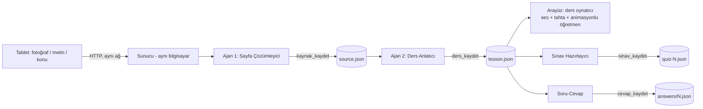

# Ders Öğretmeni (Kaptan Kelime Öğretmen)

Çocuğun gönderdiği **kitap/defter sayfası fotoğrafını, metni veya konu adını** anlayıp
animasyonlu öğretmen Kaptan Kelime ile **sesli ve görsel ders** olarak anlatan altyapı.
Ağırlık konu anlatımında; istenirse sınav hazırlar ve çocuğun sorularını cevaplar.

Bu klasör yalnızca **ajanları, talimatları, veri sözleşmelerini ve hattı** içerir.
HTTP sunucusu ve arayüz ayrı işlerdir (bkz. "Sunucu ve arayüz için yapılacaklar").

## Mimari



- Ajanlar **Cursor SDK** (`@cursor/sdk`) ile yerel olarak çalışır; model çağrıları Cursor API'si
  üzerinden yapılır. Resimler `agent.send({ text, images })` ile doğrudan modele gider.
- Her ajan yalnızca kendisine verilen **tek kayıt aracını** görebilir (`tools: ["mcp"]` + özel
  araç). Dosya, kabuk, web erişimi yoktur. Araç gelen veriyi şema ve ek kurallarla doğrular;
  hata varsa ajana geri gönderir, ajan düzeltip tekrar dener (en fazla 3 tur).
- Ajanlar boş bir çalışma klasöründe (`ogretmen-veri/.calisma`) çalışır; proje kodu bağlama girmez.

| Ajan | Talimat | Girdi | Çıktı |
|---|---|---|---|
| Sayfa Çözümleyici | `prompts/sayfa-cozumleyici.md` | resim(ler) / metin / konu, sınıf, istek | `source.json` (`SourceDoc`) |
| Ders Anlatıcı | `prompts/ders-anlatici.md` | `source.json` + resimler | `lesson.json` (`Lesson`) |
| Sınav Hazırlayıcı | `prompts/sinav-hazirlayici.md` | source + lesson, soru sayısı, istek | `quiz-N.json` (`Quiz`) |
| Soru-Cevap | `prompts/soru-cevap.md` | source + lesson + son 5 soru-cevap + soru (+resim) | `answers/N.json` (`TutorAnswer`) |

Hepsinin başına `prompts/ortak-ilkeler.md` eklenir (çocukla konuşma, doğruluk, ödev dürüstlüğü,
güvenlik). Talimatı değiştirmek için yalnızca ilgili `.md` dosyasını düzenleyin; kod değişmez.

## Klasörler

```
ogretmen/
  prompts/        ajan talimatları (tek doğruluk kaynağı)
  src/types.ts    veri sözleşmeleri (TypeScript tipleri)
  src/schemas.ts  JSON şemaları (araç inputSchema + doğrulama)
  src/validate.ts şemanın ifade edemediği kurallar (op'a göre zorunlu alan, id/hedef, svg güvenliği)
  src/agents.ts   hat: runLesson (= understand + teach), makeQuiz, askTutor
  src/store.ts    disk düzeni ve kayıt
  src/index.ts    sunucunun içe aktaracağı genel giriş
  src/cli.ts      sunucusuz deneme komutları
  ornekler/       örnek sayfa + geçerli source/lesson/quiz/answer (arayüz geliştirme için sahte veri)
ogretmen-veri/    üretilen dersler (git dışı)
```

## Kurulum

1. API anahtarı: [Cursor Dashboard → Integrations](https://cursor.com/dashboard/integrations).
   `ogretmen/.env.example` dosyasını `ogretmen/.env.local` olarak kopyalayıp anahtarı yazın
   (`*.local` git'e girmez). Anahtar yalnızca sunucuda kalır, tarayıcıya asla gönderilmez.
2. Model: varsayılan `grok-4.7`. Resim anlayan bir model gerekir; `npm run ogretmen -- modeller`
   ile erişilebilir modelleri görüp `OGRETMEN_MODEL` ile değiştirin.
3. Deneme:

```bash
npm run ogretmen -- ders --resim ogretmen/ornekler/sayfa-kesirler.png --sinif 3
npm run ogretmen -- ders --konu "Su döngüsü" --sinif 4
npm run ogretmen -- sinav <id> --sayi 5
npm run ogretmen -- sor <id> "Payda neden altta yazılıyor?"
npm run ogretmen -- liste
npm run ogretmen -- dogrula ogretmen/ornekler/lesson.json lesson
```

Kontroller: `npm test` (sözleşme testleri dahil), `npm run ogretmen:check` (tip kontrolü).
Node 22.18+ gerekir (TypeScript dosyaları derlemeden çalışır).

## Veri sözleşmeleri

Tam tanım `src/types.ts`; örnekler `ornekler/`. Özet:

- **`SourceDoc`**: `transcript` (sayfanın sadık dökümü), `regions` (resim üzerinde 0–1 normalleştirilmiş
  kutular: başlık, şekil, alıştırma...), `keyConcepts`, `learningGoals`, `exercises`,
  `uncertainties`, `safety.ok`. `safety.ok = false` ise ders üretilmez, `meta.status = "rejected"`.
- **`Lesson`**: `scenes[] → steps[]`. Her adım:
  - `say`: seslendirilecek düz metin (sayılar okunduğu gibi yazılır: "üç bölü dört")
  - `caption?`: altyazı farklıysa
  - `avatar?`: `{ mood, gesture }` → öğretmen animasyonu
  - `board?`: sırayla uygulanacak tahta komutları
  - `check?`: çoktan seçmeli kontrol sorusu; cevap gelene kadar ders bekler
- **Tahta komutları** (`BoardOp.op`): `heading`, `text`, `bullets`, `math` (düz yazım + isteğe bağlı
  `latex`), `emoji` (sayma/somut nesne), `diagram` (`flow`, `cycle`, `timeline`, `compare`,
  `table`, `numberline`, `fraction`), `image` (çocuğun fotoğrafından `box` bölgesini büyüt),
  `highlight`, `remove`, `clear`, `svg` (son çare). Hangi op'ta hangi alan zorunlu:
  `BOARD_OP_REQUIRED` (`src/validate.ts`). Tahta her sahne başında boştur; `id` sahne içinde benzersizdir.
- **`Quiz`**: `multiple_choice` (`answerIndex`), `true_false` (`answerBool`), `fill_blank` (`___`,
  `acceptedAnswers`), `short_answer` (`acceptedAnswers`), `ordering` (`orderedItems` doğru sırada).
- **`TutorAnswer`**: `steps[]` (ders adımıyla aynı yapı, boş tahtayla başlar), `onTopic`, `followUp?`.
- **`LessonMeta`** (`meta.json`): `status`: `understanding → teaching → ready` veya `rejected` / `error`.

Disk düzeni `src/store.ts` başındaki yorumda.

## Sunucu ve arayüz

Sunucu `ogretmen/src/server.ts` (`npm run ogretmen:sunucu`), arayüz haritadaki
**Kaptan Kelime'ye sor** ekranı (`src/screens/TeacherScreen.tsx`). `Baslat.cmd` ikisini birlikte açar.
Aşağıdaki kurallar sözleşmedir.

### Sunucu (Node, aynı bilgisayar)

- `ogretmen/src/index.ts` içindeki fonksiyonları kullanın; ajan mantığını yeniden yazmayın.
- `127.0.0.1:5174`'te dinleyin; Vite `server.proxy` ile `/api` → `http://127.0.0.1:5174`.
  Böylece tablet yine tek adresi (`http://<bilgisayar-ip>:5173`) kullanır ve CORS gerekmez.
- Önerilen uç noktalar:

| Yöntem | Yol | Açıklama |
|---|---|---|
| POST | `/api/ogretmen/dersler` | multipart: `resim` (0–4), `metin`, `konu`, `sinif`, `dil`, `istek`. `createLesson` ile kaydı açar, hattı arka planda başlatır, hemen `202 { id }` döner |
| GET | `/api/ogretmen/dersler` | `listLessons()` |
| GET | `/api/ogretmen/dersler/:id` | `meta.json` |
| GET | `/api/ogretmen/dersler/:id/olaylar` | SSE: `ProgressEvent` akışı (`onProgress`) |
| GET | `/api/ogretmen/dersler/:id/source` · `/lesson` | JSON |
| GET | `/api/ogretmen/dersler/:id/girdi/:dosya` | çocuğun resmi (`image` komutları için) |
| POST | `/api/ogretmen/dersler/:id/sinav` | `{ count?, request? }` → `makeQuiz` |
| POST | `/api/ogretmen/dersler/:id/sorular` | multipart: `soru`, `resim?` → `askTutor` |

- POST'ta önce `createLesson(input, config.model)` ile kaydı açıp `id`'yi döndürün, sonra
  `runLesson(id, config, onProgress)`'i arka planda çalıştırın. Başarısız bir aşama
  `understand(id)` veya `teach(id)` ile tek başına yeniden denenebilir.
- Aynı anda tek ajan çalışsın (basit kuyruk); maliyet ve hız sınırı için yeterli.
- Ağ dışına açmayın. İsteğe bağlı: ebeveyn PIN'i ve dakikalık istek sınırı.
- `CursorAgentError` (başlamadı: anahtar/ağ) ile `status: "error"` (çalıştı, başarısız) ayrı
  mesajlarla gösterilir; `meta.error` çocuğa uygun bir dille arayüzde yansıtılır.

### Arayüz (mevcut React uygulamasına yeni ekran)

- **Fotoğraf çekme:** `<input type="file" accept="image/*" capture="environment">`. Uygulama
  yerel ağda `http` ile açıldığı için `getUserMedia` (canlı kamera) çalışmaz; dosya girişi çalışır.
  Göndermeden önce canvas ile uzun kenarı ~1600 px, JPEG kalite ~0.85'e küçültün.
- **Ders oynatıcı:** adım adım ilerler. `say` → `speechSynthesis` (dile uygun ses: tr-TR, de-DE,
  en-US); konuşma bitince (`onend`) sonraki adıma geçer, ses yoksa metin uzunluğuna göre zamanlayıcı.
  Duraklat, tekrar et, önceki/sonraki adım, konuşma hızı, altyazı aç/kapa.
- **Öğretmen karakteri:** mevcut papağan çizimi (`CharacterArt` → 🦜, `src/ui/GameArt.tsx`)
  temel alınır; `mood` → yüz/renk/duruş, `gesture` → kanat hareketi, konuşurken gaga animasyonu
  (`motion` kütüphanesi). `prefers-reduced-motion` tercihine uyun.
- **Tahta:** her op için bir React bileşeni; `anim` → giriş animasyonu. `math.latex` için KaTeX
  isteğe bağlı (yoksa `text`). `image` için `girdi` resmini `box` bölgesine kırpıp büyütün.
  `svg` mutlaka DOMPurify ile temizlenir. Bilinmeyen op'u atlayın, ders durmasın.
- **Kontrol sorusu / sınav:** yanlışta `onWrong`/`hint`, doğruda `onCorrect`/`explanation`.
  Serbest cevapları `src/lang` dil paketinin `normalize` fonksiyonuyla karşılaştırın.
- **PWA:** `/api` isteklerini service worker önbelleğe almasın (`navigateFallbackDenylist: [/^\/api/]`).
  Öğretmen ekranı sunucu gerektirir; çevrimdışıyken bunu nazikçe söyleyin.
- Sabit metinler i18next'e (`src/locales/*/common.json`) eklenir.

## Genişletme

Yeni tahta komutu veya alan eklemek için sırayla: `types.ts` → `schemas.ts` → `validate.ts`
(`BOARD_OP_REQUIRED`) → `prompts/ders-anlatici.md` tablosu → `ornekler/lesson.json` → test →
arayüz bileşeni. Sözleşme `version` alanı kırıcı değişiklikte artırılır.
